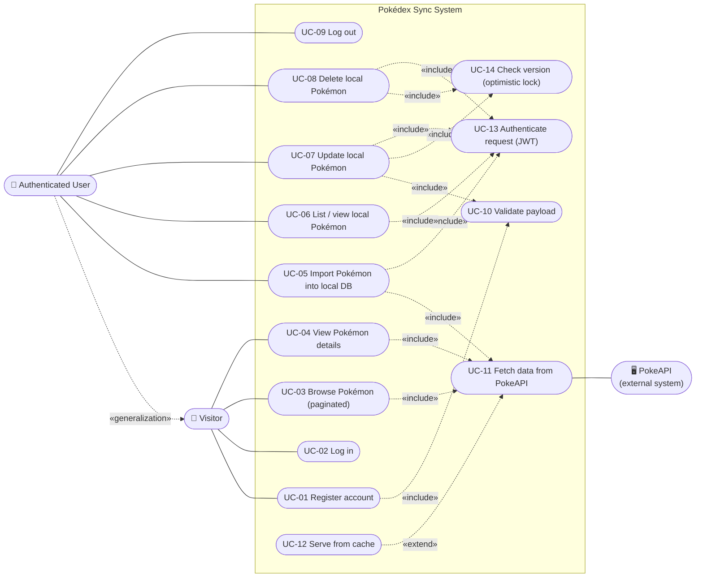

# Pokédex Sync API — Project Description

> Source of requirements: [Java_BLA_Technical_Interview_Exercise_V2.md](Java_BLA_Technical_Interview_Exercise_V2.md)

## 1. Summary

A full-stack application built around a **Java / Spring Boot RESTful API** that integrates with the public [PokeAPI](https://pokeapi.co/docs/v2). The service lets users browse and inspect Pokémon from PokeAPI, **import selected Pokémon into a local relational database**, and **enrich** those local copies with proprietary fields (localized name, geographical metadata, internal classification tags).

The backend follows **Clean Architecture** and is developed with **TDD**. It exposes CRUD over the local Pokémon dataset, plus an auxiliary **authentication API** (registration, login, public vs. protected routes, JWT for users). A modern **frontend** (e.g. React or Vue) consumes the API with a responsive, user-centric interface.

The solution is delivered in a public Git repository with a README, seeded demo data / mock credentials, and a Dockerfile.

## 2. Goals

| Goal | Description |
|---|---|
| PokeAPI integration | Retrieve Pokémon list and detail data from PokeAPI efficiently (parallel calls + caching). |
| Local replication | Import Pokémon into a relational store so the business can extend them with its own fields. |
| Local modification | Safely update locally stored Pokémon with robust validation and concurrency control. |
| Security | User registration and JWT authentication; write operations are protected. |
| Quality | Clean Architecture, high unit-test coverage, proper error handling. |
| Demonstrability | Frontend, seeded data, Docker execution, clear documentation. |

## 3. Actors

| Actor | Type | Description |
|---|---|---|
| **Visitor** | Primary (human) | Unauthenticated user. Can register, log in and access public routes (browse, detail). |
| **Authenticated User** | Primary (human) | Logged-in user (holds a JWT). Everything a Visitor can do plus protected routes: import, view, update and delete local Pokémon. |
| **PokeAPI** | Secondary (external system) | Public, read-only Pokémon data source. Called by the backend without credentials. |

> JWT is used **only for users** of our API. The backend → PokeAPI communication needs no authentication.

## 4. Features

### 4.1 US-01 — Pokémon Enumeration (public)

Users browse the full Pokémon catalog page by page (default 20 per page). Each entry shows:

- **Sprite** — the Pokémon's small image
- **Category** — the official Pokédex category (e.g. "Seed Pokémon")
- **Types** — e.g. grass, poison
- **Mass** — its weight, in kg
- **Skills** — its abilities

Key points:
- Data comes from PokeAPI, which also handles the paging of the catalog.
- PokeAPI's list only returns names, so each Pokémon's details are fetched separately, plus its species (where the category lives). To keep pages fast, the Pokémon of a page are fetched **in parallel** and results are **cached**.
- Page size has a maximum limit; invalid paging values return `400`.
- If PokeAPI is slow or unavailable (even for one Pokémon of the page), the request stops after a time limit and returns a clear error (`502`) instead of hanging.
- Cache rules: limited size, entries expire after a set time, errors are never cached, and the same Pokémon is stored only once (whether requested by name or number).

### 4.2 US-02 — Detailed View (public)

Selecting a Pokémon opens its detail page, showing:

- **Image** — the full-size artwork
- **Category and types** — e.g. "Seed Pokémon"; grass, poison
- **Core statistics** — HP, Attack, Defense, Special Attack, Special Defense, Speed
- **Description** — the short narrative text about the Pokémon
- **Evolution lineage** — the stages it evolves from and into

Key points:
- PokeAPI keeps this information in different places, so the backend combines it into a single response.
- Results are cached to avoid repeated calls to PokeAPI (same cache rules as US-01).
- An unknown Pokémon returns `404`.
- **The detail view always shows the PokeAPI data**, even if the Pokémon was imported. For logged-in users it also shows whether the Pokémon is already imported.

| Who | Pokémon imported? | Detail view shows |
|---|---|---|
| Visitor | Doesn't matter | PokeAPI data |
| Logged-in user | No | PokeAPI data + **Import** button |
| Logged-in user | Yes | PokeAPI data + "Already imported" label and a **View local version** link (instead of the Import button) |

The local version (with local name, region and tags) is a separate screen. The "imported" check is always fresh (not cached), so a Pokémon shows as imported right after it is imported.

### 4.3 US-03 — Data Synchronization (protected) — *per-item import*

- An authenticated user imports a specific Pokémon (by id or name) into the local database.
- The local database contains **only** imported Pokémon (plus seed data); PokeAPI remains the full catalog.
- The imported record keeps the PokeAPI data and adds empty **proprietary fields**:
  - `localName` — localized nomenclature
  - `localRegion` — geographical metadata (named distinctly from PokeAPI's own `habitat`)
  - `tags` — internal classification tags
- Duplicate import → `409 Conflict` (unique constraint on `pokeapiId`) — also when two users import the same Pokémon at the same moment.

### 4.4 US-04 — Local Data Modification (protected)

- **Editable:** only proprietary fields (`localName`, `localRegion`, `tags`).
- **Read-only:** PokeAPI-sourced fields (name, category, types, stats, weight, …). PokeAPI is their source of truth; a re-import would overwrite local edits.
- **Validation / error handling:**
  - `404 Not Found` — the record does not exist
  - `400 Bad Request` — malformed payload, invalid values, attempts to change read-only fields, or missing version
  - `409 Conflict` — the record was changed by someone else (see below)

**Concurrency scenarios.** The local database is shared, so several users may work on the same Pokémon at the same time:

| Scenario | Without protection | Our behavior |
|---|---|---|
| **Two users edit the same Pokémon.** Ana and Ben both open Pikachu. Ana saves first; then Ben saves. | Ben's save silently overwrites Ana's changes, which are lost. | Ben's save is rejected with `409`. Ben is asked to reload, sees Ana's changes, and applies his own on top. |
| **A user deletes a Pokémon that another user has just edited.** Ana saves a change to Pikachu; then Ben, still seeing the old version, deletes it. | Pikachu is deleted along with Ana's change, which Ben never saw. | Ben's delete is rejected with `409`. Ben reloads, sees Ana's change, and decides whether to delete. |
| **A user edits a Pokémon that another user has just deleted.** | The save could fail with an unclear error. | The save returns `404`, and the user is told that the record no longer exists. |
| **Two users delete the same Pokémon.** | The second delete could fail with an unclear error. | The first delete succeeds; the second returns `404`. |
| **A user clicks Save, Import or Delete twice** (or has the same Pokémon open in two tabs). | The second request is rejected (`409` or `404`) and confuses the user. | The Save, Import and Delete buttons are disabled while their request is in progress. Two tabs behave like two users and are covered by the version check. |
| **A user clicks "Next" quickly several times.** | Answers can arrive out of order, so the screen could show the wrong page. | The screen always shows the page the user ended on. |
| **A user opens a Pokémon that another user has deleted** (from the local list, a link, or by reloading). | Unclear error or empty screen. | The API returns `404`, and the screen shows "This Pokémon was deleted by another user" with a link back to the local list. |
| **A user sees the Import button, but another user imports that Pokémon first.** | The user's import fails, and the screen keeps showing the Import button. | The import returns `409`, and the screen refreshes to show "Already imported – View local version". |

How it works: each record carries a **version number** that increases on every change (including a change to tags only). Every save and every delete must include the version the user loaded; if it doesn't match the current one, someone else changed the record in between and the operation is rejected (*optimistic locking*). A request without a version is rejected with `400`.

> **Accepted behavior:** the local list is split into pages by position (items 1–20 on page 1, 21–40 on page 2, …). If another user adds or deletes a Pokémon while someone is moving between pages, the positions shift, so one Pokémon may appear on two pages or be skipped once. Nothing is lost or damaged, and reloading shows the correct list. This is normal for page-based lists and harmless here.

> **Accepted behavior:** an open screen does not change by itself the instant another user deletes or edits the Pokémon shown (no live updates). It updates the next time it loads data, including when the user returns to the browser tab, and any action on an outdated screen gets a clear `404` or `409`.

**Keeping screens up to date**
- **Fresh data on every screen opening:** each screen loads current data when it opens, including when the user goes back to it, changes page or returns to the browser tab. So the user sees other users' changes as soon as they move around.
- **Own changes visible everywhere:** to be fast, the frontend keeps a copy of data it already loaded. After a successful save, import or delete, it throws away the copies that contain that Pokémon (local list, local view, "imported" indicator), so going back never shows the old data.
- **An open edit form is never changed by a reload:** it keeps the data and the version it was opened with, so automatic reloads can't wipe the user's typing or skip the version check (the save still gets `409` if someone else changed the Pokémon).
- **Session expired:** the login token expires after a set time. If the user tries a protected action with an expired token, the API returns `401`, and the screen shows "Your session expired, please log in again" and opens the login screen. Unsaved changes in an open form are lost and must be typed again.

> **Accepted behavior — logout:** with JWT, logging out deletes the token in the browser; the server does not cancel it. A copied token would still work until it expires. This is standard for JWT, and the short expiry time limits the risk.
>
> **Accepted behavior — lost answer:** if a save succeeds but the answer never reaches the browser (network drop), the user sees an error and may retry. The retry gets `409`, because the first save already changed the version; the message asks the user to reload, and they will see their change was saved.

### 4.5 Supporting features

| Feature | Description |
|---|---|
| CRUD API | Create (import), Read (list + detail), Update (proprietary fields), Delete for local Pokémon; standard HTTP verbs, required parameters, consistent response structures. |
| Auth API | Registration, login (JWT issuance), public vs. protected routes. Passwords stored hashed (BCrypt). Tokens expire after a set time; an expired token gets `401`. |
| Caching | Cache mapped PokeAPI responses (summary, detail). |
| Error handling | Centralized `@RestControllerAdvice` with a consistent error body (status, message, field errors, timestamp). |
| Frontend | Responsive SPA (React/Vue): browse, detail (with "Already imported / View local version" for logged-in users), import, edit, delete, register, login; handles 409 on edit and delete. |
| Seed data | Some pre-imported Pokémon and demo user credentials. |
| Containerization | Dockerfile (optionally docker-compose with the database). |
| Documentation | README with environment setup and technical documentation. |

### 4.6 Data model

The database has two entities: **Pokemon** (the main one) and **User**.

**Pokemon** — each imported Pokémon is one record. Its fields fall into four groups:

| Group | Fields | Who sets them | Editable? |
|---|---|---|---|
| **Identification** | `id` (our own unique key), `pokeapiId` (the Pokémon's number in PokeAPI, unique so it can't be imported twice) | The system | No |
| **Data copied from PokeAPI** | name, sprite, image, category, types, weight, abilities, stats, description, evolution chain | Copied once, at import | No — PokeAPI is the source of this data |
| **Our own (proprietary) data** | `localName`, `localRegion`, `tags` (a Pokémon can have several tags) | Users | **Yes** — these are the fields US-04 updates |
| **Control** | `version` (used for concurrency, see 4.4), `createdAt`, `updatedAt` | The system, automatically | No |

**User** — each registered user is one record:

| Field | Description |
|---|---|
| `id` | Unique key |
| `username` / `email` | Unique (also enforced by the database, so two simultaneous registrations with the same username can't both succeed); used to log in |
| `passwordHash` | The password, stored as a one-way hash (never in plain text) |
| `role` | The user's role |

## 5. Use Cases

| ID | Use case | Actor(s) | Access | Related |
|---|---|---|---|---|
| UC-01 | Register account | Visitor | Public | Auth API |
| UC-02 | Log in | Visitor | Public | Auth API |
| UC-03 | Browse Pokémon (paginated) | Visitor, Authenticated User, PokeAPI | Public | US-01 |
| UC-04 | View Pokémon details | Visitor, Authenticated User, PokeAPI | Public | US-02 |
| UC-05 | Import Pokémon into local DB | Authenticated User, PokeAPI | Protected | US-03 |
| UC-06 | List / view local Pokémon | Authenticated User | Protected | US-03 / CRUD |
| UC-07 | Update local Pokémon (proprietary fields) | Authenticated User | Protected | US-04 |
| UC-08 | Delete local Pokémon | Authenticated User | Protected | CRUD |
| UC-09 | Log out (client discards JWT) | Authenticated User | Protected | Auth API |
| UC-10 | Validate request payload *(included)* | — | — | US-04 |
| UC-11 | Fetch data from PokeAPI *(included)* | PokeAPI | — | US-01/02/03 |
| UC-12 | Serve from cache *(extension)* | — | — | US-01 |
| UC-13 | Authenticate request / validate JWT *(included)* | — | — | Auth API |
| UC-14 | Check version (optimistic lock) *(included)* | — | — | US-04 |

### 5.1 Use Case Diagram

### 5.2 Use case descriptions (main flows)

**UC-03 Browse Pokémon** — The user requests a page (`page`, `size`). The system fetches the list page from PokeAPI, then fetches each item's `/pokemon/{name}` and its species in parallel (or from cache), maps sprite/category/types/weight/abilities and returns a paginated response. Selecting an item leads to UC-04.
*Alternatives:* invalid pagination parameters or size above the maximum → `400`; PokeAPI unavailable, too slow, or failing for any Pokémon of the page → `502 Bad Gateway` with a consistent error body.

**UC-04 View Pokémon details** — The user selects a Pokémon by id or name. The system aggregates `/pokemon`, `/pokemon-species` and `/evolution-chain` and returns image, category, types, stats, description and evolution lineage. For a logged-in user, it also says whether the Pokémon is imported and its local id, so the screen shows "View local version" instead of "Import".
*Alternatives:* unknown Pokémon → `404`; PokeAPI unavailable → `502`.

**UC-05 Import Pokémon** — An authenticated user requests to import a Pokémon (by id/name). The system fetches it from PokeAPI, maps it to the local entity and persists it with empty proprietary fields. Returns `201 Created`.
*Alternatives:* not authenticated → `401`; already imported (including two simultaneous imports) → `409`, and the screen refreshes to "Already imported – View local version"; not found in PokeAPI → `404`.

**UC-06 List / view local Pokémon** — An authenticated user lists the local Pokémon (paginated) or opens one of them. Returns `200`.
*Alternatives:* the Pokémon no longer exists (e.g. deleted by another user) → `404`, and the screen shows "This Pokémon was deleted by another user" with a link back to the list; not authenticated → `401`.

**UC-07 Update local Pokémon** — An authenticated user submits `localName`, `localRegion`, `tags` and the `version` they loaded. The system validates the payload, checks the version and updates the record. Returns `200` with the new version.
*Alternatives:* record not found → `404`; malformed/invalid payload, read-only field or missing version → `400`; stale version → `409`; not authenticated → `401`.

**UC-08 Delete local Pokémon** — An authenticated user removes a local record, sending the `version` they loaded. Returns `204`.
*Alternatives:* not found (or already deleted by someone else) → `404`; missing version → `400`; stale version (record changed since it was loaded) → `409`; not authenticated → `401`.

**UC-01 / UC-02 Register / Log in** — The visitor registers with unique credentials (duplicate, including two simultaneous registrations → `409`; invalid → `400`) and logs in to obtain a JWT (invalid credentials → `401`).

## 6. Non-functional requirements

- **Clean Architecture**: separation of concerns; business logic independent of API and data access.
- **TDD & testing**: unit tests for every core component; integration tests for controllers/repositories, including the concurrency scenarios of 4.4 and simultaneous imports/registrations.
- **Error handling**: centralized, consistent error contract, correct HTTP status codes (database conflicts become `409`, never `500`).
- **Performance**: parallel PokeAPI calls with timeouts; cache with size limit and expiry; bounded page size.
- **Concurrency**: optimistic locking on update and delete; unique constraints on `pokeapiId` and username/email; PokeAPI is called before opening the database transaction, so a slow PokeAPI never holds database connections. These protections live in the database, so they also work if several backend instances run at once (the cache is per instance, which only means a few extra PokeAPI calls).
- **Security**: hashed passwords, JWT, protected write routes.
- **Usability**: responsive, user-centric frontend; ideally no browser console warnings.
- **Portability**: Dockerfile for containerized execution.

## 7. Deliverables

1. Public Git repository with backend and frontend source code.
2. Unit and integration tests.
3. README: environment setup + technical documentation.
4. Seeded demo data and mock credentials.
5. Dockerfile.
6. Presentation covering user stories, design choices, architecture and a live demo, followed by a code review.
